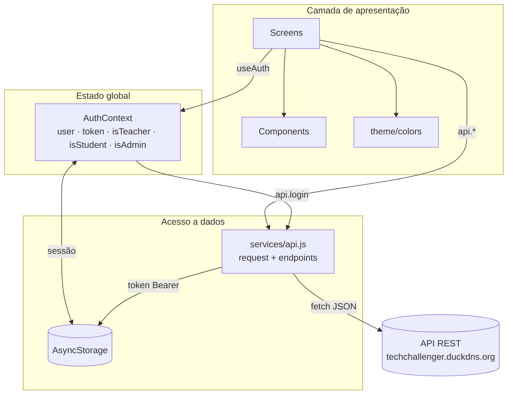
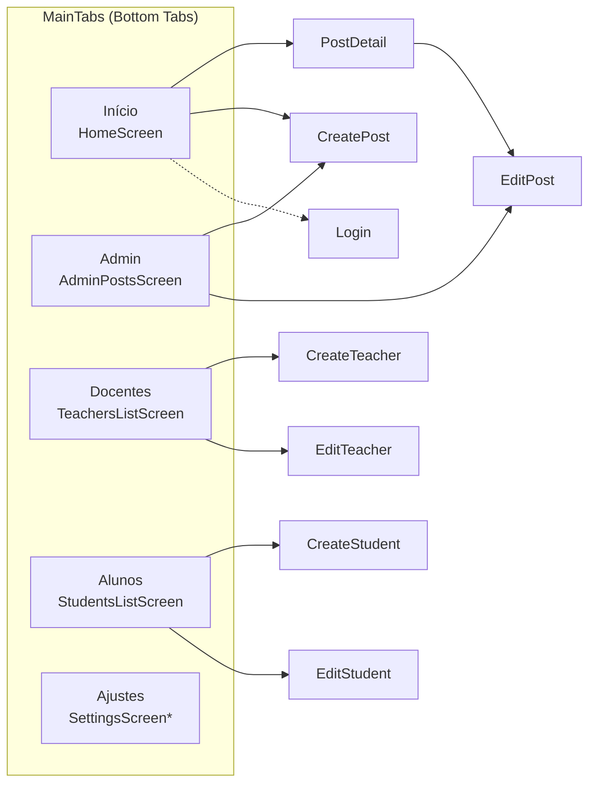
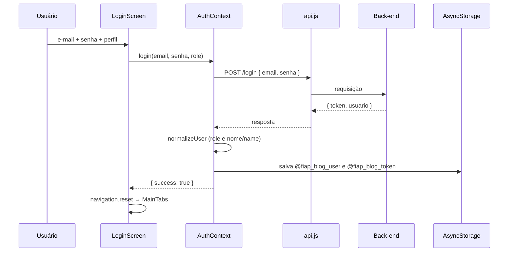

# Tech Challenge – Fase 4 · Blog Educacional Mobile

Aplicativo mobile em **React Native (Expo)** para a plataforma de blogging educacional da Pós Tech FIAP – Full Stack Development. O app consome a API REST desenvolvida nas fases anteriores e permite que **docentes** publiquem e administrem conteúdo e usuários, enquanto **alunos** leem as publicações.

> Documento complementar com arquitetura do sistema completo e o relato de experiências da equipe: [docs/DOCUMENTACAO.md](docs/DOCUMENTACAO.md).

---

## Sumário

1. [Visão geral](#1-visão-geral)
2. [Requisitos atendidos](#2-requisitos-atendidos)
3. [Tecnologias](#3-tecnologias)
4. [Setup inicial](#4-setup-inicial)
5. [Arquitetura da aplicação](#5-arquitetura-da-aplicação)
6. [Integração com o back-end](#6-integração-com-o-back-end)
7. [Guia de uso](#7-guia-de-uso)
8. [Build web, Docker e deploy](#8-build-web-docker-e-deploy)
9. [Limitações conhecidas](#9-limitações-conhecidas)
10. [Equipe](#10-equipe)

---

## 1. Visão geral

| Item | Valor |
|---|---|
| Plataformas | Android, iOS e Web (via `react-native-web`) |
| Framework | Expo SDK 58 · React Native 0.88 · React 19 |
| Back-end consumido | `https://techchallenger.duckdns.org` (Swagger em [`/docs`](https://techchallenger.duckdns.org/docs)) |
| Gerência de estado | Context API (`AuthContext`) + estado local com hooks |
| Persistência local | AsyncStorage (sessão do usuário e token) |
| Perfis | `docente`, `aluno` e `admin` (admin tem as mesmas permissões de docente) |

---

## 2. Requisitos atendidos

| # | Requisito do enunciado | Onde está |
|---|---|---|
| 1 | Lista de posts com título, autor e descrição + busca por palavra-chave | `HomeScreen`, `PostCard`, `SearchBar` |
| 2 | Leitura do post completo + comentários (opcional) | `PostDetailScreen` |
| 3 | Criação de postagens (título, conteúdo, autor) | `CreatePostScreen` |
| 4 | Edição de postagens com dados carregados | `EditPostScreen` |
| 5 | Cadastro de professores | `CreateTeacherScreen` |
| 6 | Edição de professores | `EditTeacherScreen` |
| 7 | Listagem paginada de professores com Editar/Excluir | `TeachersListScreen`, `Pagination`, `ConfirmModal` |
| 8 | Requisitos 5, 6 e 7 para alunos | `CreateStudentScreen`, `EditStudentScreen`, `StudentsListScreen` |
| 9 | Página administrativa com editar/excluir posts | `AdminPostsScreen` |
| 10 | Login de professores e proteção das páginas restritas | `LoginScreen`, `AuthContext`, guardas `isTeacher` nas telas |
| T1 | React Native com hooks e componentes funcionais | todo o projeto (`useState`, `useEffect`, `useCallback`, `useMemo`, `useFocusEffect`, `useContext`) |
| T2 | Estilização com layout próprio | `src/theme/colors.js` + `StyleSheet` em cada tela |
| T3 | Integração REST para posts, alunos, professores e autenticação | `src/services/api.js` |
| T3 | Permissões: docente cria/edita, aluno só visualiza | `AuthContext` (`isTeacher`, `isStudent`, `isAdmin`) |
| T3 | Estado global com Context API | `src/context/AuthContext.js` |
| T4 | Documentação no README | este arquivo |

---

## 3. Tecnologias

| Pacote | Uso |
|---|---|
| `expo` / `react-native` | base do app e execução em Android, iOS e Web |
| `@react-navigation/native-stack` | navegação em pilha (detalhe, formulários, login) |
| `@react-navigation/bottom-tabs` | abas principais (Início, Admin, Docentes, Alunos, Ajustes) |
| `@react-native-async-storage/async-storage` | persistência da sessão e do token |
| `react-native-safe-area-context` / `react-native-screens` | áreas seguras e telas nativas |
| `@expo/vector-icons` (Ionicons) | ícones |
| `react-native-web` / `react-dom` | build web |
| `express` / `cors` | servidor mock legado em `server/` (ver [Limitações](#9-limitações-conhecidas)) |

---

## 4. Setup inicial

### Pré-requisitos

- **Node.js 22** (mesma versão usada no Dockerfile e na esteira de CI)
- **npm**
- Para rodar no celular: app **Expo Go** (Android/iOS) na mesma rede do computador
- Para emulador: **Android Studio** (Android) ou **Xcode** (iOS, apenas macOS)

### Instalação

```bash
git clone git@github.com:carolsantoss/TechChallengeFase4.git
```

```bash
cd TechChallengeFase4
```

```bash
npm install
```

### Executando

O app já aponta para o back-end publicado, então não é preciso subir nenhum servidor local.

```bash
npm start
```

No terminal do Expo:

| Tecla / comando | Destino |
|---|---|
| `w` ou `npm run web` | navegador |
| `a` ou `npm run android` | emulador Android |
| `i` ou `npm run ios` | simulador iOS |
| QR Code | celular com Expo Go |

### Apontando para outro back-end

A URL base fica em [`src/services/api.js`](src/services/api.js):

```js
const DEFAULT_URL = 'https://techchallenger.duckdns.org';
```

Para usar uma API local, troque esse valor (ex.: `http://localhost:3000` no web/iOS, `http://10.0.2.2:3000` no emulador Android ou o IP da máquina na rede para o Expo Go). O serviço também respeita uma URL salva no AsyncStorage em `@fiap_blog_api_url` (`setBaseUrl` / `resetBaseUrl`), mas a tela que editava esse valor está desativada no momento.

---

## 5. Arquitetura da aplicação

### Estrutura de pastas

```
TechChallengeFase4/
├── App.js                    # Providers raiz: SafeArea → Auth → Navigation
├── index.js                  # registerRootComponent (Expo)
├── app.json                  # Configuração do Expo (nome, ícones, plataformas)
├── src/
│   ├── components/           # Componentes reutilizáveis
│   │   ├── Header.js         # Cabeçalho com selo do perfil, login e logout
│   │   ├── PostCard.js       # Card do post (autor, data, título, resumo, ações)
│   │   ├── SearchBar.js      # Campo de busca
│   │   ├── Pagination.js     # Controles anterior/próxima + contagem
│   │   └── ConfirmModal.js   # Modal de confirmação de exclusão
│   ├── context/
│   │   └── AuthContext.js    # Sessão, login/logout e papéis do usuário
│   ├── navigation/
│   │   └── AppNavigator.js   # Stack + Bottom Tabs
│   ├── screens/              # Uma tela por requisito funcional
│   ├── services/
│   │   └── api.js            # Cliente HTTP (fetch) e todos os endpoints
│   ├── theme/
│   │   └── colors.js         # Paleta de cores do layout
│   └── utils/
│       └── alert.js          # showFeedback: Alert nativo / window.alert no web
├── server/                   # Servidor Express mock (legado, não usado pelo app)
└── assets/                   # Ícones e splash
```

### Camadas



- **Telas** concentram a lógica de cada página: buscam dados no foco (`useFocusEffect`), controlam carregamento, validação de formulário e feedback ao usuário.
- **Componentes** são visuais e recebem tudo por props.
- **`AuthContext`** é a única fonte de verdade sobre quem está logado e o que essa pessoa pode fazer.
- **`api.js`** isola o HTTP: monta a URL, injeta `Authorization: Bearer <token>` automaticamente e converte respostas de erro em `Error` com a mensagem do back-end.

### Navegação



\* A aba **Ajustes** só aparece para usuários logados.

Todas as telas fora das abas ficam no `Stack.Navigator` raiz, com animação `slide_from_right` e cabeçalho próprio (`Header`).

### Autenticação e autorização



- Ao abrir o app, `AuthContext` restaura a sessão do AsyncStorage (`loadStoredAuth`).
- Papéis são normalizados: `teacher → docente`, `student → aluno`. `admin` herda as permissões de docente.
- Se o servidor rejeitar o login, o erro é propagado e a tela mostra "E-mail ou senha incorretos" (401) ou erro de conexão. Não existe login offline.
- Logout remove as duas chaves do AsyncStorage e limpa o estado.

**Matriz de permissões**

| Ação | Visitante | Aluno | Docente / Admin |
|---|:-:|:-:|:-:|
| Listar, buscar e ler posts | ✅ | ✅ | ✅ |
| Comentar | ✅ | ✅ | ✅ |
| Criar / editar / excluir post | ❌ | ❌ | ✅ |
| Painel administrativo | ❌ | ❌ | ✅ |
| Listar, cadastrar, editar e excluir docentes e alunos | ❌ | ❌ | ✅ |
| Alterar a própria senha (Ajustes) | ❌ | ✅ | ✅ |

As telas restritas verificam `isTeacher` e, se o usuário não tiver permissão, mostram um aviso de **Acesso Restrito** com botão para o login.

---

## 6. Integração com o back-end

Todas as chamadas passam por `request(endpoint, options)` em [`src/services/api.js`](src/services/api.js).

| Função | Método e rota | Corpo enviado |
|---|---|---|
| `login` | `POST /login` | `{ email, senha }` |
| `getPosts(search)` | `GET /posts[?search=]` | – |
| `getPostById(id)` | `GET /posts/:id` | – |
| `createPost` | `POST /posts` | `{ title, author, description, content }` |
| `updatePost` | `PUT /posts/:id` | `{ title, description, content }` |
| `deletePost` | `DELETE /posts/:id` | – |
| `addComment` | `POST /posts/:id/comments` | `{ author, content, authorRole }` |
| `getTeachers` / `getStudents` | `GET /users?role=docente\|aluno&page&limit&search` | – |
| `getTeacherById` / `getStudentById` / `getUserById` | `GET /users/:id` | – |
| `createTeacher` / `createStudent` | `POST /users` | `{ nome, email, senha, role }` |
| `updateTeacher` / `updateStudent` | `PUT /users/:id` | `{ nome, email, role }` |
| `updateUser` (troca de senha) | `PUT /users/:id` | `{ senha }` |
| `deleteTeacher` / `deleteStudent` | `DELETE /users/:id` | – |

**Formato das respostas tratado pelo app**

- Posts: o autor vem em `autor.nome`; se não vier, o app busca o usuário por `userId`.
- Usuários: o back-end devolve `nome` e o app também expõe `name`, para manter as duas formas compatíveis.
- Listas: o app aceita tanto um array direto quanto `{ data: [...] }`.

**Busca e paginação** são feitas no próprio app: a Home carrega todos os posts e filtra localmente (título, autor, descrição e conteúdo, ignorando acentos); as listas de docentes e alunos carregam os usuários, filtram pelo papel e paginam de 4 em 4 (`PAGE_SIZE = 4`). Assim a busca responde a cada letra digitada sem nova requisição.

---

## 7. Guia de uso

### Entrando no app

1. Abra o app. A aba **Início** mostra os posts mesmo sem login.
2. Toque em **Entrar** no cabeçalho.
3. Escolha o perfil (**Docente** ou **Estudante**), informe e-mail e senha e toque em **Entrar**.
4. O cabeçalho passa a mostrar o selo do perfil e o botão de sair.

**Credenciais de teste** <!-- TODO equipe: confirmar contas válidas no back-end de produção -->

| Perfil | E-mail | Senha |
|---|---|---|
| Docente | _preencher_ | _preencher_ |
| Aluno | _preencher_ | _preencher_ |

### Como aluno

- **Ler posts:** na aba Início, role a lista ou puxe para baixo para atualizar. Toque no card para abrir o post completo.
- **Buscar:** digite no campo de busca; a lista filtra na hora.
- **Comentar:** no fim do post, escreva o comentário e envie.
- **Trocar senha:** aba Ajustes → nova senha + confirmação (mínimo 6 caracteres).

### Como docente

- **Criar post:** botão flutuante **+** na Início ou **Nova publicação** na aba Admin. Preencha título, autor, resumo (opcional; se vazio, usa os primeiros 120 caracteres do conteúdo) e conteúdo.
- **Editar post:** **Editar** no card da aba Admin ou no detalhe do post. Os dados atuais já vêm preenchidos.
- **Excluir post:** **Excluir** no card da aba Admin e confirme no modal.
- **Gerenciar docentes:** aba Docentes → lista paginada com busca por nome ou e-mail; **+** para cadastrar (nome, e-mail, senha), **Editar** para alterar nome e e-mail, **Excluir** com confirmação.
- **Gerenciar alunos:** aba Alunos, com o mesmo fluxo dos docentes.

---

## 8. Build web, Docker e deploy

O app também é publicado como site estático. Os arquivos ficam na branch `main`:

- **`Dockerfile`**: imagem `node:22-alpine` que roda `npx expo export --platform web` e serve a pasta `dist` com `serve` na porta 3000. Aceita o build-arg `EXPO_PUBLIC_API_URL`.
- **`.github/workflows/ci.yaml`**: a cada push na `main`, instala dependências, roda testes (se houver), cria tag semântica (`anothrNick/github-tag-action`), gera a imagem e publica no Docker Hub como `<usuario>/techchallange-2026:mobile-<tag>`. Usa os secrets `DOCKERHUB_USERNAME`, `DOCKERHUB_TOKEN` e `JWT_SECRET`.
- **`k8s/deploy.yaml`**: `Deployment` (1 réplica) e `Service` ClusterIP no namespace `fiap`, expondo a porta 3005 → 3000.

Build local da imagem:

```bash
docker build -t techchallenge-mobile .
```

```bash
docker run -p 3000:3000 techchallenge-mobile
```

---

## 9. Limitações conhecidas

- **Comentários:** o back-end publicado não expõe `POST /posts/:id/comments` (não aparece no Swagger), então o envio de comentário pode falhar em produção. O requisito é opcional.
- **Filtros de usuários no cliente:** `GET /users` devolve todos os usuários sem aplicar `role`, `page` e `limit`; por isso o app filtra e pagina localmente. Com muitos usuários, o ideal é paginar no servidor.
- **Proteção no front-end:** a restrição de telas é feita no app. A validação definitiva das permissões precisa estar no back-end.
- **Ajustes:** a configuração da URL da API e o teste de conexão estão comentados em `SettingsScreen`; hoje a tela só troca a senha.
- **Pasta `server/`:** é o mock usado no início do projeto (dados em JSON). O contrato dele (`/login` retornando `user`, campos `name`) não é o mesmo do back-end real, então não serve como substituto direto.
- **Edição de post** não altera o autor (o campo não é enviado no `PUT`).

---

## 10. Equipe

<!-- TODO equipe: preencher nome completo e RM -->

| Nome | RM | GitHub |
|---|---|---|
| _preencher_ | _preencher_ | [@carolsantoss](https://github.com/carolsantoss) |
| _preencher_ | _preencher_ | [@aamekst](https://github.com/aamekst) |
| _preencher_ | _preencher_ | [@Don616](https://github.com/Don616) |
| _preencher_ | _preencher_ | _preencher_ |
