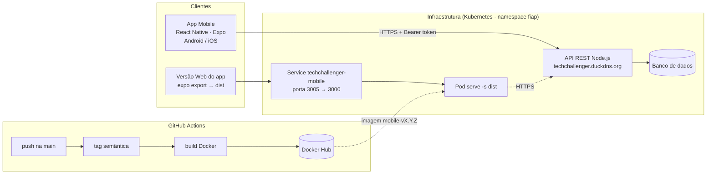

# Tech Challenge – Fase 4 · Documentação do Projeto

**Pós Tech FIAP – Full Stack Development · Fase 4 (Welcome to Mobile)**

Este documento atende ao item 3 da entrega: arquitetura do sistema, uso da aplicação e relato de experiências e desafios da equipe. Os detalhes de setup e de código estão no [README](../README.md).

---

## 1. Contexto

Nas fases anteriores a equipe construiu uma plataforma de blogging educacional: um back-end em Node.js com API REST e um front-end web em React. Na Fase 4 o objetivo foi criar a interface **mobile em React Native**, consumindo os mesmos endpoints, com uma experiência pensada para docentes (que publicam e administram) e alunos (que leem).

---

## 2. Arquitetura do sistema

### 2.1 Visão geral

| Componente | Responsabilidade |
|---|---|
| **App mobile** | Interface do usuário, controle de sessão, regras de exibição por perfil |
| **API REST** (fases anteriores) | Autenticação (`/login`), posts (`/posts`) e usuários (`/users`), documentada em Swagger (`/docs`) |
| **Versão web** | Mesmo código do app exportado para web e servido em container |
| **CI/CD** | Versionamento automático, build e publicação da imagem Docker |
| **Kubernetes** | Execução do container web e exposição via Service |

### 2.2 Arquitetura do app

O app está organizado em camadas simples, cada uma com uma responsabilidade:

1. **Apresentação** (`src/screens`, `src/components`, `src/theme`): uma tela por requisito funcional, componentes reutilizáveis (card de post, busca, paginação, modal de confirmação, cabeçalho) e uma paleta centralizada.
2. **Estado global** (`src/context/AuthContext.js`): guarda usuário, token e papéis (`isTeacher`, `isStudent`, `isAdmin`) com Context API. Qualquer tela consulta com `useAuth()`.
3. **Acesso a dados** (`src/services/api.js`): um único `request()` sobre `fetch` que monta a URL, injeta o token e padroniza os erros. Cada endpoint vira uma função (`api.getPosts`, `api.createTeacher` etc.).
4. **Persistência local** (AsyncStorage): mantém a sessão entre aberturas do app.

A navegação combina **Bottom Tabs** (Início, Admin, Docentes, Alunos, Ajustes) com um **Native Stack** para detalhe, formulários e login.

### 2.3 Decisões técnicas

| Decisão | Motivo |
|---|---|
| **Expo** em vez de React Native CLI | setup rápido, Expo Go para testar no celular sem build nativo e exportação web pelo mesmo código |
| **Context API** em vez de Redux | o único estado realmente global é a autenticação; Redux traria complexidade sem ganho |
| **`fetch` nativo** em vez de Axios | um wrapper de ~30 linhas resolve token, JSON e erros sem dependência extra |
| **Busca e paginação no cliente** | a API devolve a lista completa de usuários; filtrar no app deixa a busca instantânea e contorna essa limitação |
| **Normalização de papéis e campos** (`teacher/docente`, `name/nome`) | o app nasceu com nomes em inglês e o back-end usa português; normalizar no `AuthContext` evitou reescrever todas as telas |
| **Guardas por tela** (`if (!isTeacher)`) | cada tela restrita mostra um aviso claro de acesso negado com atalho para o login |

### 2.4 Modelo de permissões

| Perfil | Pode fazer |
|---|---|
| Visitante | ler e buscar posts |
| Aluno | ler, buscar, comentar e trocar a própria senha |
| Docente | tudo do aluno + criar/editar/excluir posts + gerenciar docentes e alunos |
| Admin | mesmas permissões do docente |

---

## 3. Uso da aplicação

### 3.1 Fluxo do aluno

1. Abre o app e vê a lista de posts (título, autor, data e resumo).
2. Usa a busca para filtrar por palavra-chave.
3. Abre um post e lê o conteúdo completo.
4. Faz login como Estudante para comentar e para trocar a senha em Ajustes.

### 3.2 Fluxo do docente

1. Faz login como Docente.
2. Na aba **Início**, usa o botão **+** para publicar.
3. Na aba **Admin**, vê todas as publicações com **Editar** e **Excluir**, além de atalhos para gerenciar docentes e alunos.
4. Nas abas **Docentes** e **Alunos**, consulta listas paginadas com busca, cadastra, edita e exclui (com modal de confirmação).

### 3.3 Mapa de telas

| Tela | Quem acessa | O que faz |
|---|---|---|
| Início | todos | lista, busca e pull-to-refresh de posts |
| Detalhe do post | todos | conteúdo completo e comentários |
| Nova publicação / Editar publicação | docente | formulários de post |
| Admin | docente | gestão das publicações |
| Docentes / Alunos | docente | listagem paginada com editar e excluir |
| Cadastro / Edição de docente e aluno | docente | formulários de usuário |
| Login | todos | autenticação por perfil |
| Ajustes | logado | troca de senha |

---

## 4. Relato de experiências e desafios

### 4.1 Linha do tempo

| Data | Marco |
|---|---|
| 13/09 | Projeto criado e primeira versão completa das telas, rodando sobre um servidor mock em Express com dados em JSON |
| 09/11 | Início da integração com o back-end real das fases anteriores |
| 10/11 – 11/11 | Ajustes de conexão, correção do filtro de busca e da paginação |
| 14/11 | Dockerização da versão web, esteira de CI/CD, manifesto Kubernetes e configuração da URL de produção |

### 4.2 Desafios técnicos

**Do mock para a API real.** A primeira versão foi construída sobre um servidor mock próprio, o que permitiu avançar nas telas sem depender do back-end. Na hora de integrar, o contrato era diferente: o login esperava `senha` em vez de `password` e devolvia `usuario` em vez de `user`; os usuários tinham `nome` em vez de `name`; os papéis eram `docente`/`aluno`/`admin` em vez de `teacher`/`student`; e professores e alunos eram um único recurso `/users`, não dois. A solução foi concentrar as conversões em dois pontos (`AuthContext` e `api.js`) para as telas continuarem funcionando com mudanças mínimas.

**Login sem "atalho offline".** A versão inicial criava um usuário fictício quando o login falhava, o que facilitava testar mas deixava qualquer pessoa entrar como docente. Na integração esse comportamento foi removido: se o servidor recusa, o app recusa.

**Busca e paginação.** A API de usuários devolvia todos os registros sem respeitar os filtros de papel e página, e a listagem misturava docentes e alunos. A equipe passou a buscar a lista completa uma vez por foco da tela, filtrar pelo papel e paginar no app (4 por página), voltando de página automaticamente quando a última fica vazia após uma exclusão. A busca de posts também passou a ser local e a ignorar acentos.

**Autor dos posts.** Nem todo post da API trazia o nome do autor. O detalhe do post usa `autor.nome` e, na falta dele, busca o usuário pelo `userId`.

**Diferenças entre plataformas.** `Alert.alert` não funciona igual no navegador, então foi criado o utilitário `showFeedback`, que usa `window.alert` no web. Também foi preciso lidar com o endereço da API em cada ambiente (`localhost`, `10.0.2.2` no emulador Android, IP da rede no Expo Go) até a API ser publicada com HTTPS.

**Atualização do Expo.** Durante o desenvolvimento o projeto migrou do SDK 57 para o 58 (React Native 0.88, React 19.3), o que exigiu alinhar versões de `react-native-screens`, `safe-area-context` e `metro-runtime`.

**Deploy da versão web.** O Dockerfile precisou de ajustes até o `expo export --platform web` gerar o `dist` corretamente. A esteira passou a versionar automaticamente com tags semânticas e publicar a imagem no Docker Hub, consumida pelo Deployment no Kubernetes.

### 4.3 Desafios de equipe

- **Trabalho em branches paralelas:** a integração com o back-end e a esteira de deploy evoluíram em branches diferentes ao mesmo tempo, e foi preciso unificá-las na `main` antes da entrega.
- <!-- TODO equipe: organização, divisão de tarefas, comunicação, prazos -->_Completar com a experiência do grupo (divisão de tarefas, comunicação, prazos)._

### 4.4 Aprendizados

- Combinar o contrato da API (nomes de campos, formatos de resposta) antes de construir as telas economiza retrabalho.
- Um mock local acelera o começo, mas precisa espelhar o contrato real.
- Concentrar integração em uma camada de serviço deixa as telas independentes do formato do back-end.
- Proteger telas no app melhora a experiência, mas a segurança de verdade tem que estar na API.
- <!-- TODO equipe --> _Completar com aprendizados individuais._

### 4.5 Próximos passos

- Implementar no back-end o endpoint de comentários e a paginação/filtragem de `/users`.
- Exigir token válido nas rotas de escrita da API.
- Reativar a configuração de URL da API na tela de Ajustes.
- Adicionar testes automatizados (Jest + React Native Testing Library) à esteira, que já roda `npm test` quando existir.
